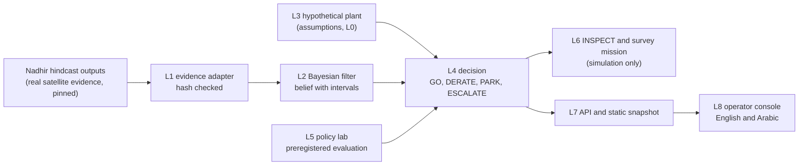

# Madkhal (مدخل, "intake")

Harmful algal blooms can foul the pretreatment of seawater reverse osmosis (SWRO) plants and
force them to stop. Satellites can watch the water near an intake, but the evidence is
imperfect: on many days there is no usable view, the detector raises false alarms, and some
blooms produce no signal at all. In the Nadhir hindcast that this project builds on, a frozen
detector caught one of three observable dated disruptions, missed two, and could not observe
two more. An operator still has to decide what to do with the intake each day.

Madkhal turns that imperfect evidence into an auditable advisory for a hypothetical SWRO
intake: GO, DERATE (with the largest safe flow and the binding constraint named), PARK, or NO
SAFE OPTION, ESCALATE when every option breaches a limit, together with an INSPECT advisory
when a drone survey would pay for itself. A Bayesian filter treats days without a satellite
view as missing information and carries the detector's uncertain error rates into every
number; a decision engine checks fouling and water security risks against explicit budgets;
and a preregistered evaluation compares the result with simple operator rules, including where
Madkhal loses. It is a proposal seed prepared by a student, not a deployment.

## Run it

Live demo on Windows (PowerShell), from the repository root:

```powershell
py -3.13 -m venv .venv; .venv\Scripts\python -m pip install -r requirements.lock.txt -e . --no-deps
.venv\Scripts\madkhal serve
npm --prefix web ci; npm --prefix web run dev
```

Run the second command in one terminal and the third in another, then open
http://localhost:5173. On macOS or Linux use `python3 -m venv .venv`, `.venv/bin/python` and
`.venv/bin/madkhal`.

Static demo (no backend; the output in `web/dist` can go on any free static host):

```powershell
.venv\Scripts\madkhal static
```

Everything else: `madkhal check` (fast check: lint, strict types, layer contracts,
traceability, claims, unit tests), `madkhal eval` (the preregistered experiments; the measured
run time is in `results/run.json`), `madkhal docs build`, and `madkhal all`.

## How it fits together



Details: `docs/ARCHITECTURE.md` (layers, data flow, deployment, sequence), `docs/METHOD.md`,
`docs/EVALUATION.md` (results, hits and misses), `docs/LIMITATIONS.md`.

## What is real and what is not

| Real | Hypothetical or synthetic |
|---|---|
| Satellite evidence from the Nadhir hindcast: Sentinel 3 OLCI for Kalba, Barka and Al Raha (2018 to 2023) and MODIS Aqua for four sites (2003 to 2014), copied byte for byte with SHA-256 hashes (`data/nadhir_snapshot/`) | The plant: a stylised SWRO unit of illustrative size that resembles no real asset; every parameter is an assumption |
| Documented events with Nadhir's evidence statuses, shown unchanged; most event dates are UNVERIFIED news report dates and all intake coordinates are ESTIMATED | The drone sensor, the wind hours and every consequence (fouling, unserved water, costs in hypothetical units) |
| The replay of advice over the real 2018 to 2023 evidence (labelled "REPLAY: real satellite evidence, hypothetical plant") | The worlds of the policy lab (generators G1 and G2), written by the same author as the method |

Every screen carries the banner: "Evidence: real satellite history from the Nadhir hindcast.
Plant, drone and consequences: hypothetical, synthetic parameters."

## What this is not

* Not a deployment and not a control system. Madkhal is advisory software for planning and
  learning. It controls nothing, writes to no plant system and has no connection to one; any
  future integration would be read only.
* Not validated against any real plant. The plant model is at evidence level L0; the path to
  calibration is a proposal (`docs/PILOT.md`, `docs/VALIDATION_PROTOCOL.md`).
* Not endorsed by, requested by or used by any organisation. Public statements that motivate
  the work are cited only in `docs/CONTEXT.md`.
* Not a flight planning tool. Exported missions are for simulation and review only; real
  flights need the operator's own safety case and the regulator's approval.
* Not a claim of compliance with any standard.

## Credits

* Evidence: [Nadhir](https://github.com/hudasol/nadhir), pinned at commit
  `ca484e231943bf16262937dd727c6408a629a704`, used as data through a hash checked snapshot.
* Decision semantics, evidence levels, spreads by provenance, sensitivity ranking and the
  policy comparison idea are ported from [Dhill](https://github.com/hudasol/dhill), commit
  `b751f002a6c61a599940c7ee932e533fbcfec627`; each ported piece is listed in
  `docs/adr/0001-licence-and-scope.md`.
* Coastline: Natural Earth (public domain). Fonts: Space Grotesk and IBM Plex, self hosted.

The Arabic interface copy is machine drafted and should be reviewed by a native speaker.

## Licence

Apache License 2.0 (`LICENSE`, ADR 0001).

## Contact

Repository owner: hudasol. LinkedIn: https://www.linkedin.com/in/huda-mueen-73bba6363/ ·
Email: hudamueen2407@gmail.com
