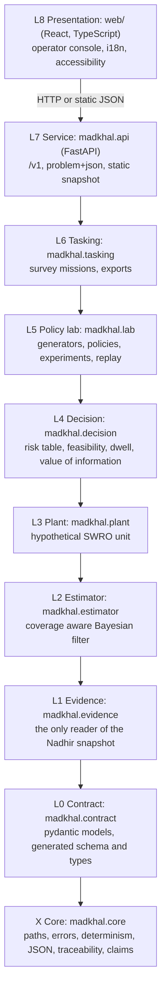
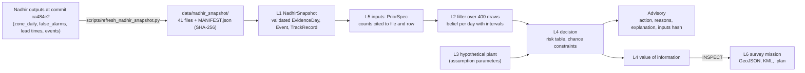
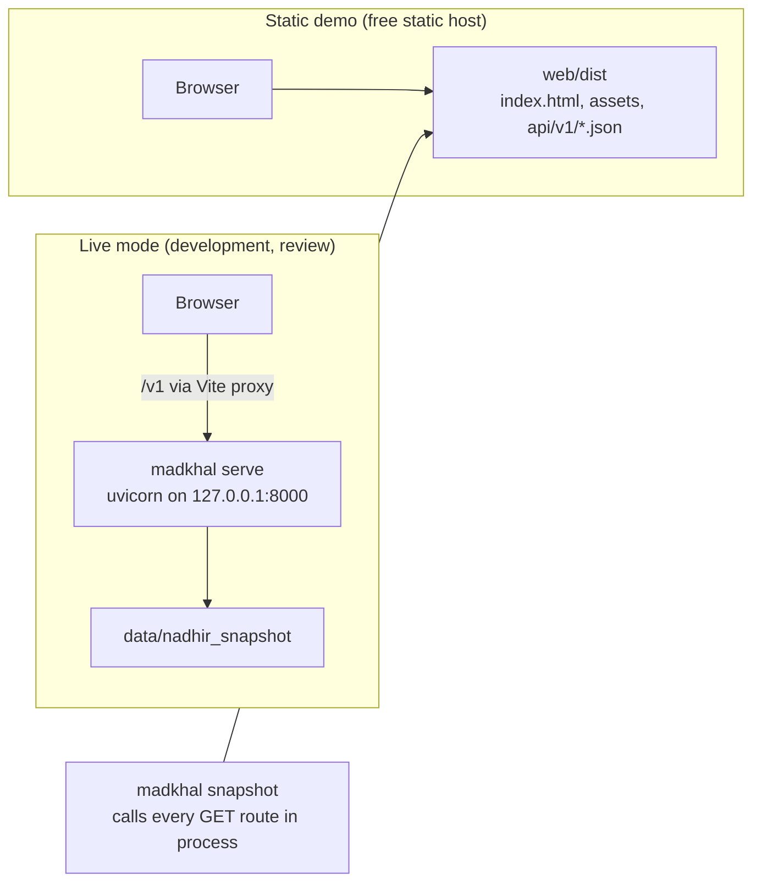
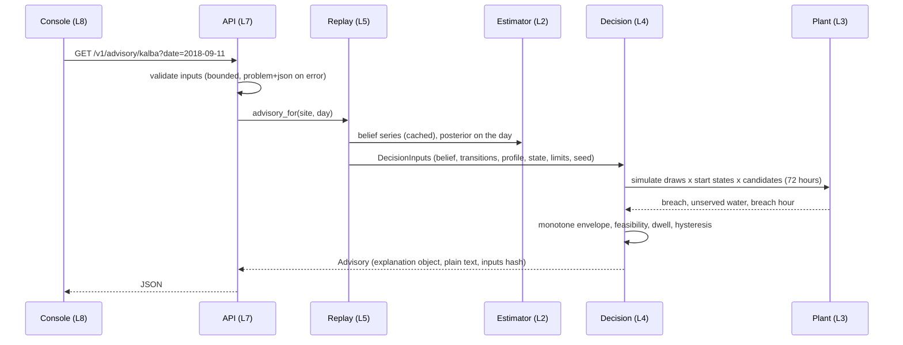

# Architecture

Madkhal is nine layers plus a cross cutting core. Dependencies point downward only, and
import-linter contracts in `madkhal check` fail the build on a violation (`pyproject.toml`).
Evidence: real satellite history from the Nadhir hindcast. Plant, drone and consequences:
hypothetical, synthetic parameters. Advisory only: nothing here connects to a plant system.

## Layers

Two contracts are enforced: the layer order above (the CLI sits on top of the API), and a
forbidden import contract that stops the estimator, plant, decision, contract and core layers
from importing the evidence layer, so that only L1 and the layers above it can reach the data.

## Data flow: from Nadhir files to an advisory and a mission

## Deployment: live mode and static demo

The static files are produced by calling the real API in process, so the two modes cannot
drift apart (ADR 0006). The web app makes no request outside its own origin: fonts are self
hosted and the map uses local GeoJSON only, with no tile service.

## Sequence: a decision request

## Cross cutting rules

* **Contract first.** `madkhal.contract` is the single source of truth; JSON Schema
  (`contract/madkhal.schema.json`), TypeScript types (`web/src/contract/types.ts`) and the
  bilingual field dictionary are generated, and a test fails when they are stale.
* **Determinism.** Every random step draws from `substream(seed, label)`. Same inputs and seed
  give identical outputs; advisories carry the SHA-256 of their inputs as their id.
* **Pure core, thin edges.** File I/O lives in L1, the CLI and the API; the estimator, plant,
  decision and lab logic are pure functions of their inputs.
* **Traceability and claims.** `docs/requirements.yaml` and `docs/claims.yaml` are checked by
  `madkhal check`; the rendered matrices are `docs/TRACEABILITY.md` and `docs/CLAIMS.md`.
